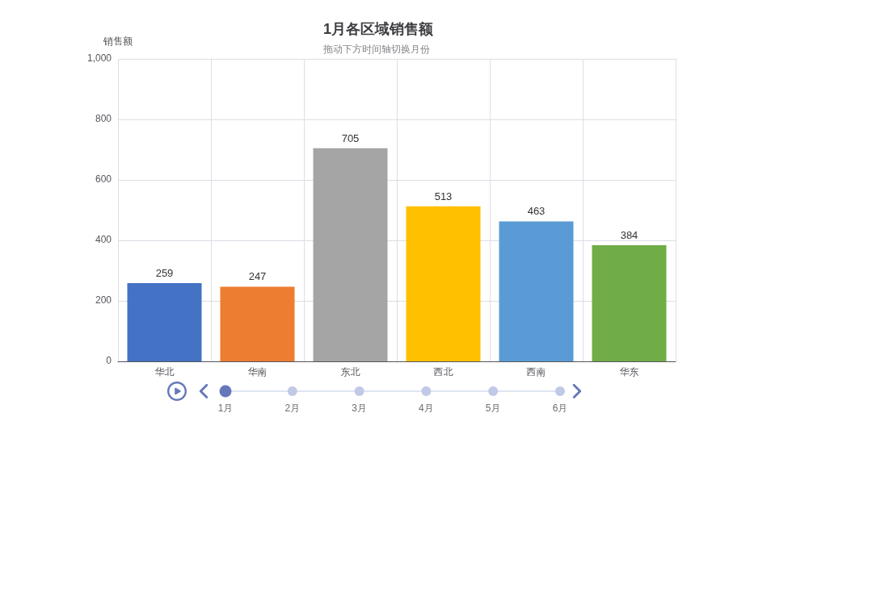

# 第三章 动态图表复现（Python 版）

用 Python（pandas + pyecharts）复现《Excel 数据可视化——从图表到数据大屏》第三章「动态图表」的 7 个案例，并整合为可拖拽的数据大屏。每个案例对应一个可独立运行的脚本，Excel 的控件交互（滚动条、选项按钮、复选框、切片器、VBA 按钮）全部以 pyecharts 的时间轴、选项卡、图例开关等价复现。

## 目录结构

```
├── charts/                          # 8 个图表脚本（可独立运行）
│   ├── common.py                    # 公共配置：配色、HTML 渲染、截图工具
│   ├── 01_动态柱形图.py              # Bar + Timeline
│   ├── 02_动态跑道图.py              # 多环嵌套 Pie + Timeline
│   ├── 03_动态南丁格尔圆环图.py      # Pie(rosetype="radius") + Timeline
│   ├── 04_动态组合图.py              # Bar + Line 双轴 + 图例开关
│   ├── 05_数据透视表切片器.py        # pandas 透视表 + Tab 选项卡
│   ├── 06_VBA动态玉玦图.py           # 多环 Pie + Tab（替代 VBA 按钮）
│   ├── 07_动态滑珠图.py              # 堆积 Bar + EffectScatter + Timeline
│   └── 08_综合数据大屏.py            # Page 可拖拽布局整合全部案例
├── images/                          # 图表截图（run_all.py 自动生成，README 引用）
├── output/                          # 交互式 HTML（run_all.py 自动生成，不入库）
├── data/                            # 案例数据（案例 5 明细较大，脚本从此读取）
│   └── 案例5_人力资源明细.csv         # 1470 条员工明细
├── 第三章_动态图表_Python实现.ipynb  # 主实验 Notebook（逐步讲解版，与 charts/ 代码一致）
├── 第三章动态图表复现-全部代码汇总.md
├── run_all.py                       # 一键运行全部脚本
├── requirements.txt
└── README.md
```

## 快速开始

```bash
# 安装依赖（Python 3.10+）
pip install -r requirements.txt

# 运行单个案例
python charts/01_动态柱形图.py

# 一键运行全部 8 个案例
python run_all.py
```

运行后：

- 交互式 HTML 输出到 `output/`，双击即可在浏览器中操作（时间轴拖动、选项卡切换、图例开关、大屏拖拽布局）；
- PNG 截图输出到 `images/`（需要 Playwright：`pip install playwright && playwright install chromium`，HTML 生成不依赖截图）；
- 图表 JS 默认从 CDN（assets.pyecharts.org）加载，打开 HTML 需要联网。

## 效果图

以下截图由 `run_all.py` 自动生成，位于 `images/` 目录：

| 动态柱形图 | 动态跑道图 | 南丁格尔圆环图 | 动态组合图 |
|---|---|---|---|
|  |  |  |  |

| 数据透视表切片器 | VBA 动态玉玦图 | 动态滑珠图 | 综合数据大屏 |
|---|---|---|---|
|  |  |  |  |

## 案例清单

| # | 案例 | 脚本 | 效果 |
|---|---|---|---|
| 01 | 动态柱形图 | `charts/01_动态柱形图.py` |  |
| 02 | 动态跑道图 | `charts/02_动态跑道图.py` |  |
| 03 | 动态南丁格尔圆环图 | `charts/03_动态南丁格尔圆环图.py` |  |
| 04 | 动态组合图 | `charts/04_动态组合图.py` |  |
| 05 | 数据透视表切片器 | `charts/05_数据透视表切片器.py` |  |
| 06 | VBA 动态玉玦图 | `charts/06_VBA动态玉玦图.py` |  |
| 07 | 动态滑珠图 | `charts/07_动态滑珠图.py` |  |
| 08 | 综合数据大屏 | `charts/08_综合数据大屏.py` |  |

## Excel → Python 机制对照

| Excel 动态机制 | Python 等价实现 |
|---|---|
| 滚动条 / 选项按钮控件 | `Timeline` 时间轴组件 |
| 组合框切换数据源 | `Timeline` / `Tab` 切换 |
| 复选框 + IF 隐藏系列 | 图例 `Legend` 点击开关 |
| 数据透视表 | `pandas.pivot_table` / `groupby` |
| 数据透视表切片器 | `Tab` 选项卡 |
| VBA 宏按钮 | `Tab` 选项卡（无需宏，无安全性限制） |
| 跑道图 / 玉玦图占位段 | 灰色占位数据段（总人数/2−数值、0.5−占比） |
| 多个工作表分散展示 | `Page` 可拖拽布局整合为数据大屏 |

## 说明

- 案例 1/2/3/4/6/7 的数据量小，直接以内嵌列表写在脚本顶部；案例 5 为 1470 条员工明细，由脚本从 `data/案例5_人力资源明细.csv` 读取。
- 每个脚本独立可运行，导入 `charts/common.py` 获取统一配色（与 Excel 默认主题接近的商务色）与输出工具。
- `第三章_动态图表_Python实现.ipynb` 为课程实验的逐步讲解版 Notebook，代码与 `charts/` 目录保持一致。
- `.github/workflows/render.yml` 会在每次推送时自动运行 `run_all.py` 并提交最新的 `images/` 截图。
- 截图仅为初始状态示意（时间轴/选项卡需打开 HTML 交互体验）。

## License

MIT
